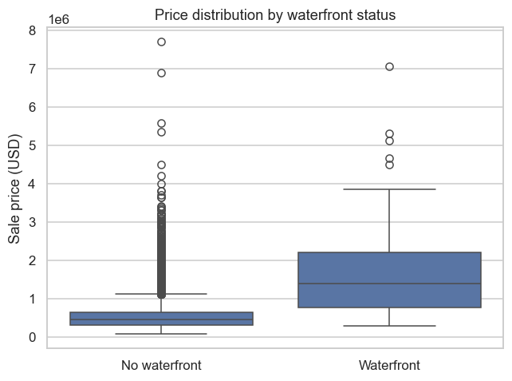

# Jinxin

I am a data science student at the University of Macau. I build analyses that
start from a clear question, show the evidence in charts, and are documented well
enough for someone else to rerun them.

## Technical Skills

Python · pandas · NumPy · matplotlib · seaborn · scikit-learn · Jupyter ·
Git and GitHub · data cleaning · exploratory data analysis

## Project Showcase

### What Drives House Prices in King County?

**Research question:** How much of a house's sale price can be explained by its
physical attributes and its location?

**What the chart shows:** Waterfront homes are rare — 163 of 21,597 sales — but
their median price is 1.4 million USD against 450,000 USD for other homes, a 3.1x
premium. The wider spread in the waterfront group also shows why a single average
hides a lot.

**Repository:** https://github.com/NessieQAQ/data-science-project

**Status:** Completed

## About This Site

This portfolio is published with GitHub Pages from the `index.md` file in this
repository. The project code, figures and run instructions live in the project
repository linked above.
